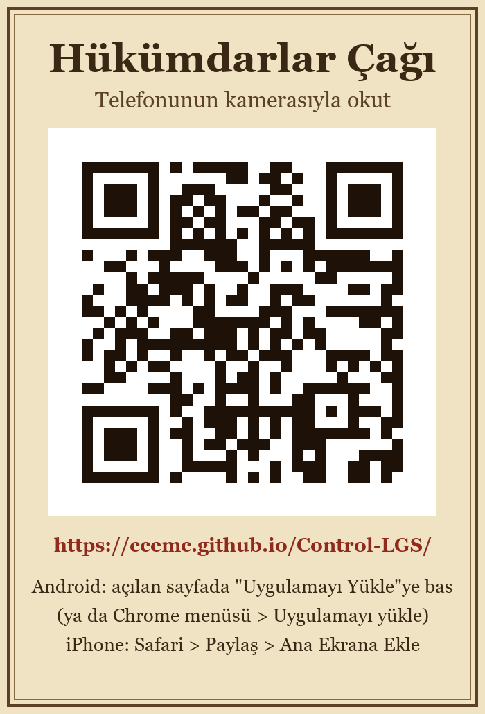

# Hükümdarlar Çağı

Eski harita temalı 2D strateji oyunu. Şimdilik 8 bot ülkeye karşı oynanır.
Bilgisayarda ve telefonda çalışır; telefona **uygulama (PWA)** olarak yüklenebilir.

## ▶ Hemen oyna: https://ccemc.github.io/Control-LGS/

Telefona yüklemek için kamerayla okut, açılan sayfada **Uygulamayı Yükle**'ye bas
(iPhone: Safari → Paylaş → Ana Ekrana Ekle).

**Güncelleme yayınlamak:** dosyaları değiştir, `sw.js` içindeki `VERSION` değerini arttır, sonra
`git add -A`, `git commit -m "açıklama"`, `git push`. Site 1-2 dakika içinde güncellenir; telefondaki uygulama
bir sonraki açılışta yeni sürümü alır.

## Bilgisayarda oyna

- `oyunu-baslat.bat` dosyasına çift tıkla (Python gerekir) → tarayıcıda `http://localhost:8080` açılır.
- Sunucusuz da çalışır: `index.html` dosyasını doğrudan açabilirsin (bu durumda çevrimdışı önbellek çalışmaz).

## Telefonda oyna (aynı Wi-Fi)

1. Bilgisayarda `telefonda-oyna.bat` dosyasına çift tıkla. Ekranda `http://192.168.x.x:8080` gibi bir adres yazar.
2. Windows güvenlik duvarı sorarsa **Özel ağlar** için izin ver.
3. Telefonun tarayıcısında o adresi aç, **Mobil** modu seç, Başla. Oyun tam ekrana geçer.
4. İstersen tarayıcı menüsünden **Ana ekrana ekle** ile kısayol oluşturabilirsin.

> Not: Yerel ağ adresi `http://` olduğu için tarayıcılar burada tam "uygulama yükleme" ve internetsiz çalışmaya izin vermez.
> Bunun için oyunun **https** bir adreste olması gerekir (aşağıya bak).

## Gerçek uygulama olarak yükle (ikon, tam ekran, internetsiz)

1. Oyun zaten GitHub Pages'te yayında: https://ccemc.github.io/Control-LGS/
2. Telefonda o adresi aç:
   - **Android (Chrome):** giriş ekranında çıkan **📲 Uygulamayı Yükle** butonuna bas (ya da menü → *Uygulamayı yükle*).
   - **iPhone (Safari):** **Paylaş → Ana Ekrana Ekle**.
3. Artık ana ekrandaki ikondan açılır; internet olmadan da çalışır.

**APK dosyası istersen:** HTTPS adresini [PWABuilder](https://www.pwabuilder.com) sitesine ver; Android paketini (APK/AAB) oluşturup indirir.

## Uygulama özellikleri

- Ana ekran ikonu, tam ekran açılış, yatay ve dikey düzen, çentikli ekran desteği
- **Otomatik kayıt:** her 10 sn'de ve uygulama arka plana geçince kaydeder; giriş ekranında **Kaldığın Yerden Devam Et**
- Oyun açıkken ekran kararmaz; saldırı/savaş bildirimlerinde titreşim
- Uygulama arka plandayken oyun duraklar
- **Ses ve müzik** (dosyasız, tamamı tarayıcıda üretilir): barışta sakin müzik, savaşta taiko davullu savaş müziği, çatışmada daha yoğun hali;
  kılıç sesleri, savaş boruları, fanfar, füze/patlama, para ve arayüz sesleri. Üst çubuktaki 🔊 düğmesi (ya da **M**) sesi açar/kapatır.

## Savaş kuralları (kısaca)

- **Başkent düşerse devlet yıkılır.** Kalan şehirler isyancılara geçer, hazinenin yarısı fatihe ganimet olur.
- Saldırı yavaştır: düşman şehrine yürüyüş 12 sn, ardından çatışma askerlerin sayısına göre 9–45 sn sürer; iki taraf da çatışma boyunca eriyerek kayıp verir.
- Haritada saldırı **OpenFront gibi** izlenir: savaştaki ülkelerin ortak sınırı kırmızıya döner, saldırı yolundaki sınır kırmızı yanıp söner,
  çatışma sürerken saldıranın rengi sınırdan şehrin içine doğru yavaş yavaş yayılır (şehir üstünde %ilerleme yazar).
- Saldıran birlik, çatışma bitene kadar komuta edilemez. **Saldırı altındaki şehirdeki askerler şehri terk edemez**, savunmak zorundadır (takviye gönderilebilir).
- Her şehrin askeri, haritada toprağın üzerine yazılır (altın alt çizgi = senin birliğin).

## Kontroller

| PC | Mobil |
|---|---|
| WASD / ok tuşları: kamera | Sürükle veya D-pad |
| Tekerlek: yakınlaştır | İki parmak / + − |
| Birliğe (veya birlikli şehre) tıkla → miktar seç → hedef şehre sol tıkla | Dokun |
| Q / sağ tık / Esc: iptal | İptal butonu |
| 1–4: menüler, Boşluk: başkente dön, M: sesi aç/kapat | Alt (yatayda sağ) menü çubuğu, 🔊 düğmesi |

## Dosyalar

- `js/mapgen.js` — Voronoi + kıvrımlı sınırlarla harita, petek düzeninde eşit aralıklı 9 başkent, eşit şehir dağılımı
- `js/game.js` — oyun kuralları, kayıt/yükleme. DOM kullanmaz; tüm eylemler `cmd*` komutlarıyla gelir
- `js/bot.js` — bot yapay zekâsı (oyuncuyla aynı komutları kullanır)
- `js/render.js` — harita, birlikler, efektler, minimap
- `js/ui.js` — menüler, diyaloglar, gelen iletiler
- `js/main.js` — giriş ekranı, oyun döngüsü, girişler, uygulama (PWA) özellikleri
- `manifest.webmanifest`, `sw.js`, `icons/` — mobil uygulama dosyaları.
  Oyun dosyalarını değiştirirsen `sw.js` içindeki `VERSION` değerini arttır ki telefonlar yeni sürümü alsın.

## Çevrimiçiye geçiş notu

`Game` sınıfı arayüzden bağımsız ve komut tabanlı. Çok oyunculu için `game.js` + `mapgen.js` + `bot.js` bir Node sunucusunda
çalıştırılır; istemciler `cmdMove`, `cmdPropose`, `cmdBuy`… çağrılarını WebSocket mesajı olarak gönderir, sunucu durumu yayınlar.
